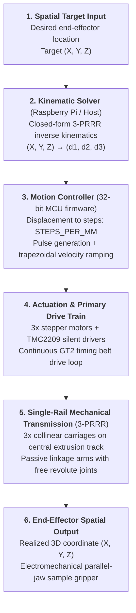
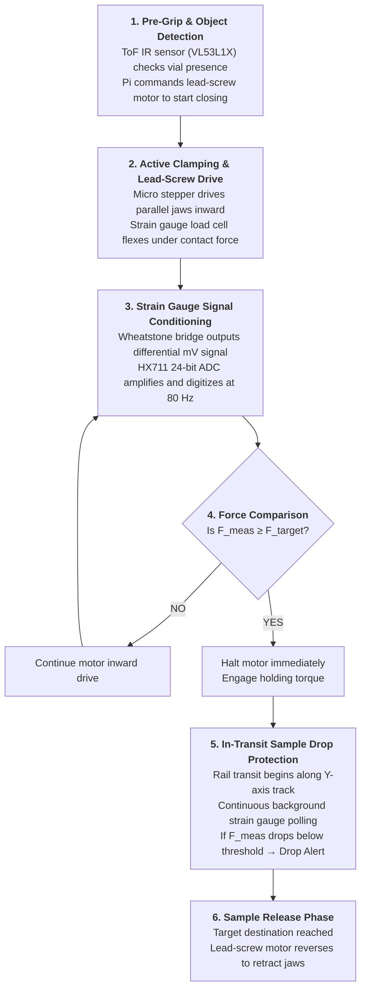
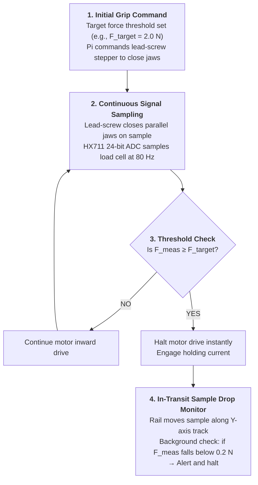
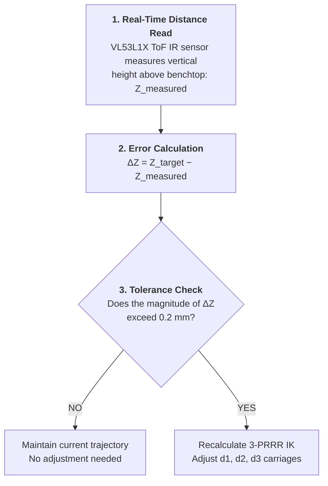
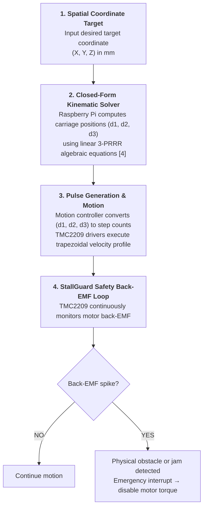

# Kinematics and End Effector

**Time.** 00:00–00:00, location.

## Discussion

What was discussed.
# 3-PRRR Sample Handler: System Flowcharts

This document describes the full signal and control flow for the single-rail 3-PRRR parallel manipulator and its sample gripper.

---

## 1. Overall System Pipeline

From a target coordinate to the realized end-effector position.

---

## 2. Gripper Operation Sequence

Full lifecycle of a pick, transit and release.

---

## 3. Gripper Force Control Loop

The closed loop that clamps the sample at a fixed force and monitors for drops.

---

## 4. Z-Height Closed-Loop Correction

Uses the ToF sensor to correct vertical error against the benchtop.

---

## 5. Motion Planning and StallGuard Safety

From target coordinate to motion, with jam detection.

## Decisions

Main controller: https://www.pishop.ca/product/raspberry-pi-4-model-b-4gb/
Low level communication: STM32 Nucleo connected with drivers

## Action items

- [ ] Kinematic Solver to target step counts — Khushmeet, 2026-11-7
